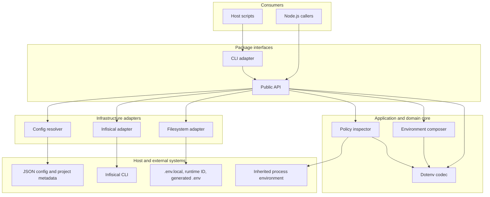
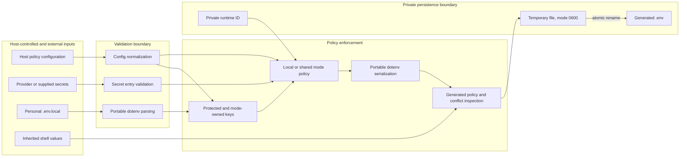
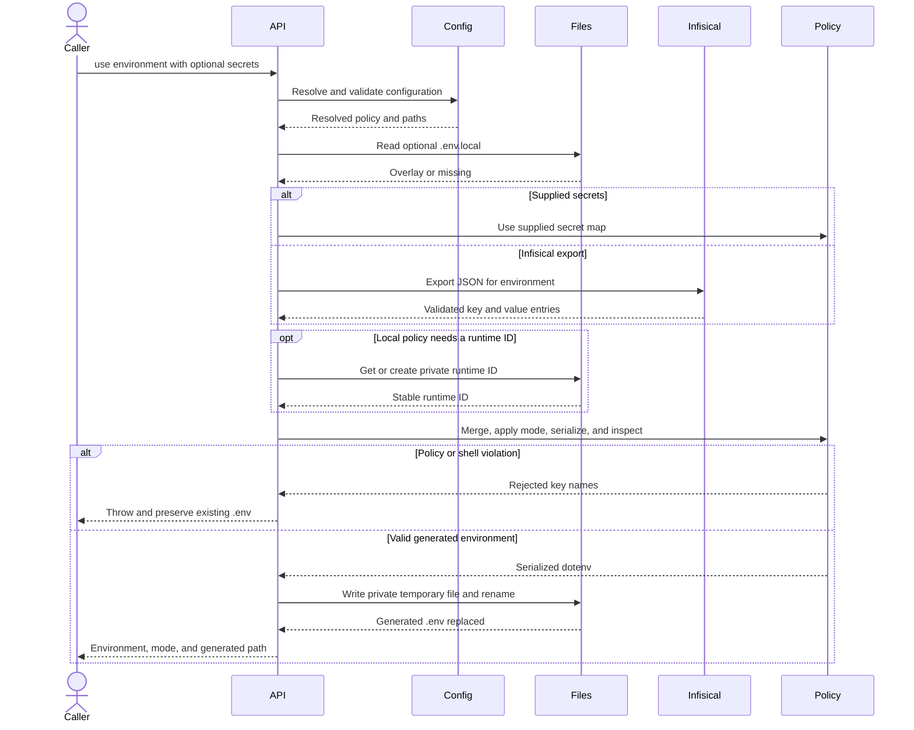
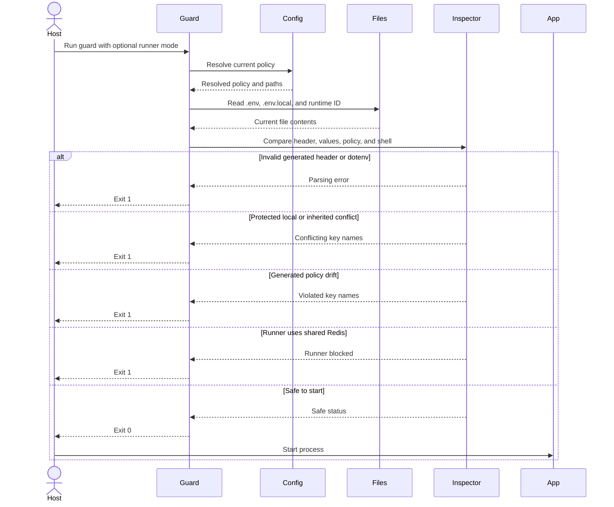

# Design

This document describes the runtime design and safety boundaries of
`local-env-switch`. See the [README](./README.md) for installation and usage.

## Goals

- Keep project-specific environment names and key policy in host configuration.
- Produce one deterministic generated `.env` from explicit inputs.
- Prevent personal overrides and inherited shell values from replacing protected
  settings silently.
- Make local Redis the default mode and require an explicit opt-out for shared
  Redis.
- Replace the generated `.env` atomically and never print secret values.

The package is not a general secret store, process supervisor, Redis server, or
shell environment loader. It delegates secret retrieval to the Infisical CLI
unless the programmatic caller supplies a `secrets` object.

## Layered architecture



The public API owns orchestration. Composition, inspection, and dotenv handling
form the domain core; adapters contain configuration discovery, the external
CLI, and file operations.

## Safety and policy architecture



The package enforces four external boundaries:

- JSON configuration resolved by `resolveConfig` is normalized and checked for
  invalid keys, patterns, environment references, URLs, duplicates, and
  file-path collisions. The internal JSON reader is not part of the package
  facade; `resolveConfig` owns the public validation contract.
- Infisical output must be a non-empty JSON array of unique string key/value
  entries with portable environment key names. Programmatically supplied secret
  maps are runtime-checked for string values before any file or network access.
- `.env.local` is parsed before secret retrieval and cannot contain protected or
  mode-owned keys.
- inherited process values are compared by key name; errors report names only.

The merge order is:

```text
preset < secrets < .env.local < selected mode policy
```

Mode policy is authoritative. In local mode it removes configured literal key
prefixes, forces every configured Redis key to the local URL, then applies local
overrides. In shared mode it applies only shared overrides.

## Environment switch sequence



`useEnvironment()` returns only switch metadata. Secret values stay inside the
orchestration boundary; callers that explicitly use lower-level composition or
provider helpers remain responsible for not logging or persisting them.

## Guard sequence

The guard is designed to run immediately before a development process or local
worker starts.



## Invariants and failure behavior

- The first two generated lines bind the file to `toolName`, environment, and
  Redis mode. A missing or edited header is rejected.
- Required keys are checked after all overlays and mode policy are applied.
- Keys owned by either mode, local Redis, or local deletion prefixes are
  protected automatically.
- A local runner is rejected while shared Redis mode is active.
- A failed export, parse, policy check, or serialization does not replace the
  existing generated `.env`.
- The runtime ID is stored separately and may be created before a later switch
  check fails; it contains no secret.
- Atomic rename prevents partial `.env` reads. Concurrent switches are not
  serialized: if two valid switches run at the same time, the last rename wins.
- Parent directories for configured file paths must already exist.

## Module responsibilities

| Module | Responsibility |
| --- | --- |
| `config` | Discover, normalize, and validate host JSON configuration. |
| `infisical` | Run the external CLI and validate its JSON boundary. |
| `compose` | Merge values, apply mode policy, and inspect drift/conflicts. |
| `dotenv` | Parse and serialize the supported portable dotenv subset. |
| `files` | Read optional files, manage runtime IDs, and replace `.env` atomically. |
| `api` | Orchestrate switch, status, and guard operations. |
| `cli` | Parse commands, render safe messages, and set process exit status. |
